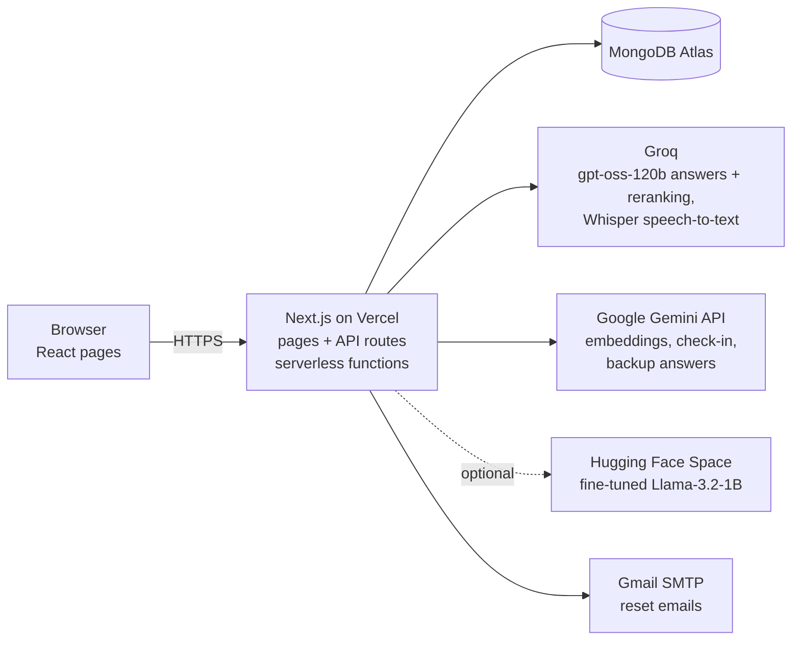
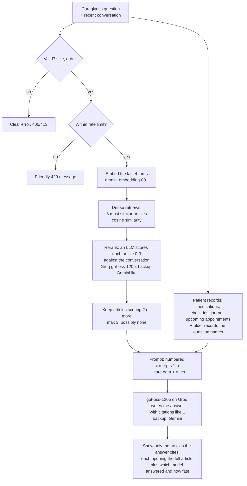

# Neura — complete project context

*Last updated 19 Oct 2026, late evening (§14A covers the interface and user-experience work of 18–19 Oct; §14B covers the features added on the evening of 19 Oct: fast open-weight model on Groq, voice input, doctor share links, clickable sources, new logo). This file replaces `docs/report-context.md` and `docs/session-recap.md`, which describe an older state of the project (e.g. SHA-256 passwords, no automated tests, the original RAG pipeline). Where they disagree, this file is correct.*

**How to use this file.** Everything here is true of the code and measurements as of the date above. Use it to write the report and slides, or paste it into an AI assistant and ask it to help, one chapter or slide at a time. Anything not yet done is marked **[TO FILL]** — never replace those with invented numbers. Plain-English explanations of technical terms are in the [glossary](#20-glossary).

---

## 1. Summary

**Neura** is a web app that helps **family caregivers of people living with dementia**. A caregiver creates an account, sets up a profile for the person they look after, and then uses one dashboard to:

- track **medications** (taken / pending),
- manage **appointments**,
- keep a **care journal** with mood tags,
- run a short, gentle **AI-led cognitive check-in** with the patient, scored and saved over time,
- ask an **AI Care Assistant** caregiving questions, answered from a curated knowledge base **and** the patient's own records, with sources shown,
- download a **PDF care report** to take to the doctor,
- **share** the patient profile with a second caregiver (e.g. a sibling),
- send the patient's doctor a **private, read-only, expiring link** to a clinical summary,
- **speak** instead of typing (speech recognition with OpenAI's Whisper), and have check-in questions **read aloud**.

**One-line pitch (for a title slide):** *Neura puts a dementia patient's day-to-day care in one place and gives caregivers safe, sourced AI guidance grounded in trusted content and the patient's own records.*

**What makes it more than a CRUD app:** two AI features (a conversational check-in and a retrieval-augmented assistant), speech recognition, a self-trained open-source model with a hosting pipeline, a **switchable model layer** (Gemini, a fast open-weight model on Groq, or the self-trained Llama, with automatic fallback), and — the strongest part for an academic report — an **evaluation-driven upgrade** of the AI in four measured phases, each compared against a fixed baseline.

**Live site:** https://neura-app-final.vercel.app · **Code:** https://github.com/Nashmia/neura-app-final

---

## 2. Problem, users and objectives

**Problem.** Dementia care is usually spread across family members, paper notes, memory and many websites. Caregivers are often stressed, untrained and short on time. General-purpose chatbots answer confidently but can invent facts, can't see the patient's records, and don't show where advice comes from — risky in a health setting.

**Users.** Primary and secondary family caregivers (main users). The patient takes part only in the check-in, supervised by the caregiver.

**Objectives** (usable as the "Aims & Objectives" section):
1. Build a responsive, accessible full-stack web app for caregiver record-keeping.
2. Replace a static multiple-choice memory quiz with a **personalised conversational AI check-in**.
3. Build a **Retrieval-Augmented Generation (RAG)** Care Assistant that answers from curated content and the patient's live data, with explicit safety rules and visible sources.
4. Demonstrate an end-to-end **fine-tuning and self-hosting pipeline** for an open model.
5. Support **multi-caregiver collaboration** on a shared patient profile.
6. Deploy to the cloud and verify it end to end.
7. **Evaluate the AI rigorously and improve it in measured steps**, keeping a fixed baseline so every change can be compared.
8. Make the app **accessible to older users**: voice input and read-aloud questions, large text, keyboard and screen-reader support.
9. Let caregivers **share information with clinicians safely**, without giving them an account.

---

## 3. Features (functional modules)

| Module | What the caregiver can do | Notes |
|---|---|---|
| Accounts | Sign up, log in, log out, reset a forgotten password by email | Login locks for 15 min after 5 wrong passwords; reset links expire after 30 min |
| Landing page | Public marketing page: hero with 3D sculpture artwork and floating feature cards, problem, how it works, features, sample dashboard previews, benefits, FAQ, call to action | Redesigned 18 Oct; see §14A |
| Onboarding | Create the patient profile **once**: name, age, gender, dementia stage, notes, family/friend contacts (optional photo), check-in length (3–8) and difficulty | Four steps with Back/Continue; the draft survives a page refresh; photos are compressed in the browser before upload. After it is done it is never shown again (§7) |
| Sharing | Invite a second caregiver with a code/link; both see the same patient | Invite codes are signed and expire after 7 days |
| Medications | Add, list, mark taken/pending | No edit or delete (not supported by the backend). The status only changes on screen once the server has saved it |
| Appointments | Add (Doctor / Therapy / Other, date, time, location, notes), list, cancel | Upcoming and past shown separately; cancelling asks for confirmation; no edit or delete |
| Journal | Notes with an optional mood tag (Calm, Anxious, Confused, Happy, Tired) | One tap records one mood entry, with a confirmation |
| Dashboard | Summary of everything, check-in score chart | Recharts |
| Cognitive check-in | A short AI conversation with the patient, scored at the end. Answers can be typed or **spoken**; questions can be **read aloud** | See §8 and §14B |
| Care Assistant | Ask caregiving questions (typed or spoken); answers cite their sources, and each source opens the full guidance article. A small label shows which model answered and how long it took | See §9 and §14B |
| Doctor sharing | Create a private, read-only link to a printable clinical summary for the patient's doctor; revoke all links at once | Signed, expires after 7 days, no account needed; see §7 and §14B |
| Care report | One-page A4 PDF: medication adherence, recent scores, upcoming appointments, recent notes | Generated on the server |
| Profile & settings | Edit your own name and phone; edit the patient's details and family/friends (with photos); see the care team; create caregiver invites and doctor links | Email is read-only (it is the sign-in identity). Edits update the existing patient in place, so no history is lost (§14A) |

**Design.** "Calm Navy" interface (navy and periwinkle palette), works on phones including older iPhones (the build targets Safari/iOS 15+). The app screens use **DM Sans** for text and **Source Serif 4** for headings; the landing page uses **DM Serif Display** for headings and **Manrope** for text (§14A). The logo is a **glowing wave** (the curve from the landing page's closing artwork) beside a lowercase "neura" wordmark (§14B).

---

## 4. Technology stack

| Layer | Technology | Why it was chosen |
|---|---|---|
| Framework | **Next.js 16** (App Router), **React 19**, **TypeScript** | Pages and backend API in one codebase; type safety |
| UI | Tailwind CSS v4, Radix-based components, lucide icons, Framer Motion (app pages), Recharts; Google fonts via `next/font` (DM Sans, Source Serif 4; landing: DM Serif Display, Manrope) | Fast, consistent, accessible, responsive. Landing-page animations use plain CSS and the browser's IntersectionObserver, so the public page ships no animation library |
| Validation | react-hook-form + **Zod** | The same rules checked in the browser and on the server |
| Database | **MongoDB Atlas** (official driver) | Managed cloud database, flexible documents, free tier |
| AI answers | Switchable by one setting (`ASSISTANT_MODEL_PROVIDER`): **Groq** running OpenAI's open-weight **gpt-oss-120b** (live setting), **Google Gemini** (`gemini-3.8-flash`, fallback `gemini-flash-lite-latest`; also the automatic backup), or the self-trained Llama on Hugging Face | Groq's inference chips answer in about a second; Gemini is strong with a free tier; any failure falls back to Gemini |
| Speech | OpenAI **Whisper Large v3** (speech-to-text) on Groq; browser speech synthesis (read-aloud) | Accurate, accent-tolerant transcription in about a second; read-aloud needs no service |
| AI embeddings | Gemini `gemini-embedding-001` (3,072-number vectors) | Semantic search for RAG |
| Fine-tuning | Google Colab (free T4 GPU), **Unsloth**, Hugging Face TRL, **QLoRA** on **Llama-3.2-1B-Instruct** | Free, memory-efficient training of an open model |
| Model hosting | Hugging Face Spaces (Docker, FastAPI + Transformers) | Free hosting of the fine-tuned model |
| Email | nodemailer via Gmail SMTP | Password-reset emails |
| PDF | @react-pdf/renderer | Server-side reports |
| Hosting | **Vercel** (serverless functions) | Native Next.js hosting, auto-deploys from GitHub; a preview copy for every branch |
| Testing | Node's built-in test runner (`npm test`, 43 tests), custom evaluation harness (`npm run eval:rag`) | No extra dependencies |

---

## 5. Architecture

- **Pages** (`app/`): landing, signup, login, forgot/reset password, onboarding, dashboard, medications, appointments, journal, chat (check-in), assistant, **assistant/sources/[source]** (a cited guidance article), settings, join, and the public **doctor/[code]** (read-only clinical summary, no login).
- **Route guards:** each signed-in page has a small server `layout.tsx` that checks access before the page is sent (§7).
- **API routes** (`app/api/`), 21 in total: auth (signup, login, logout, forgot/reset password), me, onboarding, **profile** (caregiver), **patient** (patient profile), dashboard, medications, appointments, journal, `chat/quiz`, `assistant/chat`, reports, invite, join, settings, **doctor-share** (create or revoke doctor links) and **transcribe** (speech to text). Each runs as a short-lived **serverless function**.
- **Shared logic** (`lib/`):
  - `db.ts` — database access (MongoDB, or a local JSON file for offline development), rate-limit counters
  - `auth.ts` — passwords, sessions, invite codes, doctor share codes
  - `doctor-share.ts` — checks a doctor link and gathers the read-only summary
  - `access.ts` — the access rules (who may open which page), and the safe `?next=` check
  - `guard.ts` — applies those rules on the server for every protected page
  - `profile.ts` — create the patient once, edit caregiver and patient profiles
  - `chat-validation.ts` — conversation checks and size limits
  - `quiz.ts`, `quiz-limits.ts` — the server-side check-in
  - `rate-limit.ts` — per-user limits
  - `assistant-context.ts` — the Care Assistant's prompt, patient data and citation parsing
  - `retrieval.ts` — the retrieve-then-rerank pipeline
  - `patient-records.ts` — date/intent-aware record selection
  - `gemini.ts`, `embeddings.ts`, `finetuned-model.ts`, `groq.ts` — calls to the AI models (`groq.ts` also picks an available model automatically)
- **Components** (`components/`): `ui/` (buttons, inputs, cards), `layout/` (app sidebar, page shell, logo, report button, history guard), `brand/` (the logo component), `settings/` (profile forms, doctor-share card), `voice/` (microphone button), `doctor/` (print button), `landing/` (header, hero art, cards, FAQ, scroll reveal).

---

## 6. Data model (MongoDB collections)

| Collection | Main fields |
|---|---|
| users | id, name, email, phone, passwordHash (scrypt), sessionVersion, loginFailures, loginLockedUntil, resetTokenHash, resetTokenExpires, createdAt |
| patients | id, userId (owner), caregiverIds[], name, age, gender, dementiaStage, notes, contacts[] (embedded), quizLength, quizDifficulty, **doctorShareVersion** (bumped to revoke doctor links), timestamps |
| medications | id, userId, patientId, name, dosage, time, status (Taken/Pending) |
| appointments | id, userId, patientId, title, type, date, time, location, notes, status (Upcoming/Cancelled), createdAt |
| journalEntries | id, userId, patientId, text, moodTag, createdAt |
| quizSessions | id, userId, patientId, score, total, summary, **items[]** (every question and answer, since Phase 2), createdAt |
| quizTranscripts | a check-in in progress: questions asked, answers so far, question count, status, version (Phase 2) |
| rateLimits | per-user request counters that delete themselves when their time window ends (Phase 2) |
| knowledgeChunks | id, source, title, text, embedding (3,072 numbers) — 32 articles |

**Relationships:** a user owns patients; a patient can have several caregivers (`caregiverIds`, many-to-many); a patient has many medications, appointments, journal entries and check-ins. Contacts are stored inside the patient document.

---

## 7. Security, privacy and reliability

**Accounts**
- Passwords hashed with **scrypt** and a random salt per password. Older SHA-256 hashes still work and are upgraded on the next login.
- Sessions: an HTTP-only cookie signed with HMAC-SHA256, valid 30 days, marked Secure over HTTPS. Changing your password signs out every other session (the session version is bumped).
- Lockout after 5 wrong passwords for 15 minutes.
- Password reset by email: only a hash of the token is stored, and it expires after 30 minutes.
- The server refuses to run in production without `AUTH_SECRET` (there is no default secret).

**Access control.** Only caregivers listed on a patient (`caregiverIds`) can see that patient's data; every API route checks the session and works only on the caregiver's own patient.

**Access model for pages (since 19 Oct).** Rules in `lib/access.ts`, applied on the server by `lib/guard.ts` on every request, refresh and typed URL:

| Visitor | Opens a signed-in page | Opens onboarding | Opens login / signup |
|---|---|---|---|
| Signed out | sent to login, then back to that page (`?next=`) | sent to login | allowed |
| Signed in, no patient yet | sent to onboarding | allowed | sent to onboarding |
| Signed in, onboarding done | allowed | sent to the dashboard | sent to the dashboard |

- **"Onboarding done"** means a saved patient record lists the caregiver. It lives in the database, so it holds across refreshes, new tabs and new logins, and a failed save can never mark it done.
- **Onboarding is one-time on the server too:** a second submission is refused (HTTP 409), so it can't overwrite the patient or create a duplicate.
- **`?next=` is safe:** only same-site paths are accepted, so it can't send people to another website.
- **Back after logout:** browsers can restore a page from their back/forward cache without asking the server. Signed-in pages now reload when that happens, so Back after logout shows the login page instead of patient data.

**Doctor share links (since 19 Oct).**
- The link holds `patientId.version.expiresAt.signature`, signed with HMAC-SHA256 and a separate "doctor" purpose, so it can't be forged, edited or swapped with a caregiver invite code (tested).
- It expires after **7 days**. "Revoke all doctor links" bumps `doctorShareVersion`, which turns off every link issued before.
- The summary shows caregiver **names only**, never emails, phones or account details. The page tells search engines not to index it.
- It is a **bearer link**: anyone holding it can read the summary until it expires or is revoked, so caregivers are told to share it only with the doctor.

**AI safety (Phase 2)**
- **Conversation checks:** the server validates every conversation sent to the assistant — role order, size limits (2,000 characters per message, 64 KB per request) and the newest 12 turns kept — so malformed or oversized input never reaches the model.
- **Prompt-injection guard:** retrieved text is treated as *evidence, not instructions*.
- **Medical safety rule:** never diagnose and never advise starting, stopping or changing a medication or dose; refer the caregiver to the doctor. Urgent situations (falls, getting lost, sudden severe confusion) are escalated.
- **Score integrity:** check-in scores can't be faked. The server stores the questions and answers itself and grades from that record; whatever history the browser sends is ignored.

**Rate limits (Phase 2).** Per user, stored in the database so they hold across serverless instances:

| What | Short-term | Daily |
|---|---|---|
| Care Assistant questions | 6 per 10 minutes | 30 per day |
| Check-in messages | 12 per 10 minutes | — |
| New check-ins | — | 3 per day |
| Voice recordings (transcription) | 30 per 10 minutes | — |

Going over a limit returns a friendly "please wait about N minutes" message.

**Reliability**
- **Retries:** Gemini's temporary "high demand" errors are retried up to 4 times, with growing waits.
- **Quota fallback:** when the main model's quota runs out, answers come from the lite model, and the server log notes it.
- **Reranker fallback:** if the reranker fails, retrieval falls back to the older top-4 search.
- **Model fallback (since 19 Oct):** if Groq or the self-hosted model fails, the answer comes from Gemini, and the reply's label says "Gemini (fallback)" with the reason underneath. If every model fails, the error message names each provider's error (never keys or patient data).
- **Knowledge-base cache:** the 32 articles are kept in memory for 10 minutes per server instance instead of reloaded from MongoDB on every question (that load measured about 5 s).
- **Voice is optional:** if the microphone is blocked or speech recognition is unavailable, a plain message appears and typing works as before.

**Privacy and ethics.** Neura holds sensitive health-related information about a vulnerable person:
- It uses data minimisation and access control.
- It shows sources for transparency.
- It is **not a medical device** and the check-in is **not a diagnostic test**.

---

## 8. AI feature 1 — the cognitive check-in

- **No fixed question bank.** Gemini writes each question live, from a prompt built for the specific patient: name, age, dementia stage, family and friends, chosen length and difficulty.
- **What it asks about:**
  - orientation (day, time, season)
  - recall of familiar people
  - daily routine
  - simple recognition

  Questions come one at a time, in short warm language, and are never upsetting, medical or embarrassing. The patient answers in their own words.
- **Structured output:** the model replies in a fixed JSON format (question / complete, number, total, score, summary), so the app can follow the conversation reliably.
- **Grading:** at the end the model grades charitably (partial credit for close answers) and writes a short summary for the caregiver.
- **Since Phase 2, the server controls it:**
  - The browser sends only a session ID and the latest answer. The questions and answers are kept on the server, and the model is shown the server's copy.
  - The server decides when the check-in ends.
  - The saved score is limited to between 0 and the number of questions.
  - Every question and answer is saved, so a score can be audited.
- **Length:** 3–8 questions everywhere. Onboarding used to allow up to 20 while the check-in quietly stopped at 8. Short check-ins don't tire the patient, and each question costs one request from a small daily quota.
- **Voice (since 19 Oct):** the patient can answer by speaking (Whisper transcribes it into the answer box, which can be corrected before sending), and a "Read aloud" switch speaks each question at a slightly slower pace. The check-in itself still runs on Gemini.
- **Honesty note:** this is an engagement and tracking tool. It is **not** a clinically validated test (it is not the MMSE or MoCA).

---

## 9. AI feature 2 — the Care Assistant (RAG)

**RAG in one sentence:** before the AI answers, the app *retrieves* the relevant trusted articles and the patient's records and puts them into the prompt, so the answer is *grounded* in real content rather than the model's memory.

**Knowledge base.** 32 curated articles (`scripts/knowledge-base.ts`), one per topic:
- wandering, sundowning, sleep, agitation, hallucinations, paranoia, repeated questions
- communication, validation and reminiscence therapy
- bathing, incontinence, mealtimes, nutrition, medication management
- home safety, driving, emergencies, warning signs, doctor visits
- routines, exercise, assistive technology, holidays, talking to children, denial
- caregiver burnout, respite care, support groups, legal and financial planning, end of life, stages of dementia

Each article is converted once into an **embedding** (a list of 3,072 numbers capturing its meaning) and stored in MongoDB.

**How a question is answered today** (after Phases 2 and 3):

**Key rules in the prompt:**
- use only the excerpts and the care data
- cite excerpts as [1]–[3], and name care-data sources in plain words ("your journal note on 15 Oct says…")
- ignore excerpts that don't help
- if the answer isn't there, say so plainly instead of guessing
- write dates in words, never numerically like 11/10
- never diagnose or advise on doses

**Patient records (Phase 3).** By default the prompt includes:
- the medications
- the 3 newest check-ins and the 5 newest journal notes
- appointments still to come (status Upcoming **and** dated today or later)

If the question names a date ("on the 9th of October", "yesterday") or a period ("this week"), the older notes from then are added. If it asks about progress ("since her first check-in"), the full check-in history is added.

**Which model writes the answer.** Chosen by one setting, `ASSISTANT_MODEL_PROVIDER`:

| Setting | Model | Notes |
|---|---|---|
| `groq` (**live since 19 Oct**) | OpenAI's open-weight **gpt-oss-120b** on Groq | About a second to generate. The app asks Groq which models the key can use and picks the best: Llama first, then gpt-oss, then Qwen. Groq no longer serves Llama chat models (`llama-3.1-8b-instant` returned "model not found"), so gpt-oss-120b is used. The reranker also runs here |
| unset | Google Gemini | The previous default, and always the automatic backup |
| `finetuned` | The self-trained Llama-3.2-1B on Hugging Face (§10) | Falls back to Gemini after 25 s or on any error. Measured on 19 Oct: 32 s to wake the free Space, about 10 s per short reply; not used live |

Every reply shows a small label, for example "Answered by openai/gpt-oss-120b via Groq · 0.9s". On a fallback it says "Gemini (fallback)" and gives the reason. **[TO FILL]** the typical Groq time shown in that label during your demo.

---

## 10. AI feature 3 — the fine-tuned model

**Version 1 (first fine-tune):**
- **Data:** about 200 synthetic caregiver Q&A pairs, generated by Gemini from the knowledge-base articles, plus hand-written "boundary" examples where the right answer is to refer to a doctor.
- **Training:** Llama-3.2-1B-Instruct, QLoRA on a free Colab T4 GPU. Merged and published as `nashmiaadnan/neura-care-assistant`.
- **Serving:** a Hugging Face Space (FastAPI). Confirmed from the published config: 16 layers, hidden size 2048, i.e. the 1B model.
- **[TO FILL]** the final training and validation loss from the original Colab run, if you saved them.

**The problem found in Phase 4 — "train–serve mismatch".** The model learned from a one-line prompt and a bare question, but the app sends a long prompt: numbered articles, patient data and rules (about 1,050 tokens). Benchmarked on the real prompt (report `2026-10-17T13-15-14`):
- **Citations:** 0 of 5 answers cited any source, and every answer was a single sentence.
- **p04:** wrong medication information (Donepezil said to be pending when it was taken; Sertraline missing).
- **i01:** it **invented** what the neurologist said. Gemini correctly said it had no record.
- **p06:** it correctly declined the dose change.
- **Latency:** 9–13 s per answer on the free CPU Space when awake.

**Version 2 (retraining pipeline, Phase 4):**
- **Same prompt as production:** every training example is built with the exact production prompt code.
- **283 examples** (254 for training, 29 for validation):

  | Kind | Count | Purpose |
  |---|---|---|
  | Knowledge questions | 167 | answered from the top 3 articles |
  | Distractor-only | 31 | given only irrelevant articles, to teach "the guidance doesn't cover this" |
  | Patient-record questions | 57 | over 6 synthetic patients |
  | Unanswerable questions | 19 | the answer must say Neura has no record |
  | Safety questions | 16 | the answer must refer to a doctor |

- **Teacher:** answers written by **Gemini Flash-Lite**, because the main model's free tier allows only 20 requests a day.
- **Quality filters** reject answers that:
  - contain invalid citations
  - write numeric dates
  - are knowledge answers without a citation
  - are unanswerable questions answered anyway
  - are safety answers with no doctor referral

  1 answer was rejected. The teacher's formulaic opener "Neura doesn't have a record of that, but…" was removed from all 17 safety answers.
- **No test leakage:** questions too similar to any evaluation question were removed (37). The closest remaining pair shares only a topic.
- **Colab notebook** (`training/finetune_context_colab.ipynb`):
  - QLoRA on Llama-3.2-1B, with sequences up to 3,072 tokens
  - learns from the **answers only** (the long prompt is context, not something to imitate)
  - keeps the epoch with the lowest validation loss
  - reports citation, abstention and doctor-referral rates
  - publishes to a **new** repo (`neura-care-assistant-v2`), so the current model isn't replaced
- **Space** now reports per-request latency: prompt tokens, answer tokens, seconds, tokens per second.
- **[TO FILL]** after you run the notebook:
  - validation loss per epoch
  - the behaviour-check rates (cell 7)
  - the v2 benchmark results with `npm run eval:rag -- --answers --ids=k01,p01,p04,p06,i01 --provider=finetuned`, and your rubric scores

**Honesty notes.**
- The data is synthetic (generated from curated articles), which is normal and defensible for a small domain fine-tune.
- The aim is to demonstrate a self-trained, self-hosted alternative, not to beat Gemini.

---

## 11. How the AI was evaluated

**The approach: evaluation-driven development.** First measure a baseline, then change one thing at a time and re-measure against the same tests. The baseline is never edited.

**Test set — 45 cases** (`evaluation/test-cases.ts`):

| Kind | Cases | Examples |
|---|---|---|
| Knowledge questions ("easy", written knowing the article titles) | 10 | "My mother keeps asking what day it is…" |
| Questions spanning two articles | 2 | wandering at night + home safety |
| Multi-turn follow-ups | 5 | "what changes can I make so it doesn't happen again?" |
| Patient-record questions | 10 | moods, medications, appointments, check-in progress, a dose-change request |
| Insufficient information | 3 | "What were her blood pressure readings this week?" |
| **Hard** caregiver-style questions | 15 | "im so tired, he keeps getting up at night and walking round the house at 3am" |

The hard questions were written the way a stressed caregiver types — vague, misspelt, emotional, sometimes two topics — *before* looking at the article titles, then labelled.

**Synthetic patient.** "Evelyn Test" (`evaluation/fixtures/synthetic-patient.json`) has medications, check-ins, journal notes and appointments, including a past appointment still marked Upcoming. The evaluation never touches real patient data; it only reads the knowledge-base articles.

**Metrics**
- **Retrieval:**
  - hit rate @4 — is the right article in the top 4?
  - hit rate @1
  - mean reciprocal rank (MRR)
  - since Phase 3, for the articles actually sent to the model: hit rate, precision, how many are sent, and how many questions needing no article get none
- **Patient context:** does the prompt contain the facts the question needs (and not the ones it shouldn't)?
- **Answers:** scored by you on a 0–2 rubric for groundedness, correctness, source attribution and safety (`evaluation/RUBRIC.md`), plus automatic checks (citations, numeric dates). An optional AI judge exists but is advisory only and off by default.
- **Latency:** embedding, ranking, reranking, generation, end to end.
- **Cost:** every API request is counted, including hidden retries.

**Faithfulness to production.** The evaluation imports the app's own code (`lib/assistant-context.ts`, `lib/retrieval.ts`), so it measures exactly what the live app does. A check fails loudly if the route stops using that code.

**Reproducibility.** Each run saves a JSON and a Markdown report with the date, git commit, models and settings. "Today" is pinned to 17 Oct 2026. Answers vary slightly between runs (temperature 0.4).

---

## 12. Results by phase

All from `evaluation/reports/`. Branch history: `main` (Phase 1) → `phase-2-safety` → `phase-3-retrieval` → `phase-4-finetune`, merged to `main` via pull request #1.

### Retrieval

| | Phase 1 baseline (dense top 4) | Phase 3 (articles actually sent) |
|---|---|---|
| Easy cases: right article sent | 100% (16/16) | 100% (16/16) |
| **Hard cases: right article sent** | **86.7% (13/15)** | **94.1% (16/17)** |
| Precision of articles sent | ≤ 0.25–0.5 (4 sent, 1–2 relevant) | **0.64** |
| Articles sent per question | 4 | **1.6** |
| Questions needing no article that got none | 0 of 12 | **11 of 12** |
| Right article among the 8 candidates | — | 100% |

Phase 2 doesn't change retrieval, so its numbers equal Phase 1.

### Patient context (does the prompt contain what's needed?)

| Phase 1 | Phase 2 | Phase 3 |
|---|---|---|
| 7/10 (p03, p07, p10 fail) | 8/10 (p07 fixed: past appointments) | **10/10** (p03, p10 fixed: date- and intent-aware records) |

### Answers (the same 5 cases: k01, p01, p04, p06, i01)

| | Phase 1 | Phase 2 | Phase 3 |
|---|---|---|---|
| Sources shown per answer | 4 (always) | 0–2 (only cited) | 0–2 |
| Ambiguous numeric dates | 1 ("11/10") | 0 | 0 |
| Human rubric score | **31/40** (groundedness 8, correctness 8, attribution 5, safety 10) | **[TO FILL]** score `reports/2026-10-17T12-40-10/scoring-sheet.csv` | **[TO FILL]** score `reports/2026-10-17T12-56-40/scoring-sheet.csv` |

### Other measurements
- **An early finding that shaped the design:** cosine similarity scores can't separate relevant from irrelevant articles. An unanswerable question's best match scored 0.669, higher than a genuine correct match at 0.656. So **no similarity cut-off** was used; Phase 3's relevance judge replaced it.
- **Remaining failure:** h10 (a near-fall *and* missed pills in one message). The second article scored 2, but the cap of 3 was filled by three articles scoring 3. It was left as is rather than tuning the cap to one test case.
- **Query rewriting:** follow-ups passed 5/5 with and without it, so it's off by default (it would cost a call and about 1.3 s).
- **Latency:** embedding about 0.5 s; ranking 32 articles about 0.3 ms; reranking about 1.3 s median; answer generation about 6–9 s; loading the articles from MongoDB 2.5–4 s in evaluation runs (including connecting).
- **Fine-tuned model v1:** see §10.

---

## 13. Key engineering decisions (good for the viva)

| Decision | Why |
|---|---|
| Measure first, then change one thing per phase | Each improvement has evidence and can be attributed; a fixed baseline prevents "it feels better" |
| No similarity threshold (Phase 2) | The baseline showed scores overlap (0.669 irrelevant vs 0.656 relevant); a threshold would drop good articles or keep bad ones |
| Show only cited sources | Removes irrelevant sources without a threshold; makes attribution checkable |
| Quiz graded from a server-stored transcript | The browser can't be trusted; storing questions and answers also makes scores auditable |
| Rate limits stored in MongoDB, not memory, not Redis | Serverless instances don't share memory; Redis would add a service for no measured need |
| Gemini reranker instead of a cross-encoder | A local cross-encoder needs a ~300 MB runtime, over Vercel's 250 MB function limit; a hosted one adds a provider. The 0–3 relevance score gives a meaningful threshold |
| Query rewriting built but off | No measured gain once the reranker reads the conversation; it would cost latency and quota |
| Patient records selected by rules, not semantic search | Dates and record types are structured data; rules are exact, free and testable |
| Dates in words, fixed time zone | The server's locale wrote 11/10/2026 locally but 10/11/2026 on Vercel — ambiguous for a health record |
| Fine-tune v2 on the production prompt, answers only | Fixes the train–serve mismatch measured in Phase 4 |
| Phase 5 (vector database, Redis, other models) deferred | Ranking 32 articles takes 0.3 ms; the real bottlenecks are API calls and the free quota |
| Access checked in server layouts, not only in the browser | Runs before any page is sent, on every refresh and typed URL; the API routes still check access independently, so hiding a page is never the only protection |
| "Onboarding done" = a saved patient record, not a separate flag | One source of truth that can't drift out of sync, needs no database migration, and can't be set by a failed save |
| Answers served by an open-weight model on Groq, not the fine-tuned model | Free CPU hosting made the fine-tuned 1B model take 10–15 s and its v1 answers were unreliable (§10). Groq's inference chips answer in about a second; Gemini stays as the automatic backup, so a provider outage never breaks the assistant |
| Pick the Groq model at runtime instead of hard-coding it | Groq retired the model first used (404 "model not found"), and later offered no Llama chat model at all; asking the API which models exist keeps the app working without code changes |
| Doctor access by signed, expiring link instead of doctor accounts | Doctors get the information without registering; the caregiver stays in control (7-day expiry, instant revoke); no new roles or permissions system to build and secure |
| Voice by recording + Whisper, not the browser's built-in recogniser | Works in every modern browser (the built-in one is Chrome-only), handles accents well, and is a named, explainable ML model; typing stays available |
| Patient edits update the record in place | All history is stored by patient id, so editing never orphans medications, journal entries, appointments or check-ins |

---

## 14. Challenges and how they were solved

**Deployment (earlier):**
1. Weeks of work were uncommitted. → Committed, and Vercel was connected to GitHub.
2. MongoDB wouldn't connect, for three separate reasons found one after another:
   - The home network blocked the TLS handshake. → Confirmed with `openssl`, outside the app.
   - Vercel couldn't resolve `mongodb+srv` DNS records. → Switched to a standard connection string.
   - An old free-tier cluster had a known TLS bug. → Created a new cluster.
3. Scripts crashed on the `server-only` import guard. → Run them with `--conditions=react-server`.
4. AI routes could exceed the serverless time limit. → Set `maxDuration = 60`.
5. Gemini returned frequent 503 "high demand" errors. → Pinned the model version and added retries. The free 20-requests-a-day quota → automatic fallback to the lite model.

**Recent:**
6. **Accounts:** password reset didn't exist and hashing was weak. → Email reset, scrypt, lockout, session revocation.
7. **Older iPhones** couldn't run the app (Next 16 targeted newer Safari features), and login failed because WebKit dropped Secure cookies over plain HTTP. → Browser target set to iOS 15+, and the Secure flag based on the real protocol.
8. **Dummy data** was shown and saved. → Removed.
9. **Locale-dependent dates** could flip day and month between servers. → Fixed date format in a fixed time zone.
10. **Local development** was quietly using the old fine-tuned model (set in `.env.local`), giving poor answers. → Found while debugging end-to-end tests; documented.
11. **Sign-up broke after deployment** because Vercel's variables had been switched to Preview only, so production lost `AUTH_SECRET`. → Diagnosed with harmless probes; fixed by re-enabling the variables for Production and redeploying.
12. **Gemini's free quota** (20 requests a day on the main model) runs out quickly during testing. → The live app falls back to the lite model; the training data used the lite model as teacher.
13. **The self-hosted model was too slow for a live demo** (32 s to wake the free Space, about 10 s per reply on CPU) and no free GPU was available. → Answers moved to an open-weight model on Groq, with Gemini as the backup; the fine-tuned model stays as the training and hosting demonstration.
14. **Groq rejected the configured model**, first "model not found" (`llama-3.1-8b-instant` retired), then no Llama chat model at all on the key. → The app now asks Groq which models exist and picks the best available (gpt-oss-120b). The cause was found quickly because each reply shows which model answered and, on fallback, why.
15. **The assistant took over 10 s** even when working. → Measured each step (knowledge-base load about 5 s, search and rerank about 5 s, Gemini answer about 5 s), then cached the knowledge base and moved reranking and generation to Groq.
16. **The development laptop ran out of memory** during local builds and dev servers. → Verified with the type-checker, tests and HTTP checks locally, and relied on Vercel's cloud build, which keeps the previous version live if a build fails.

---

## 14A. Interface and user-experience work (18–19 Oct 2026)

### Landing page (18 Oct)

| Change | Why |
|---|---|
| **Hero artwork rebuilt.** The old hero was one 822×454 image with the card labels baked in, so it was blurry on any screen above 1× density. It is now a sculpture-only render served at 1× and 2× (`public/hero-sculpture-*.webp`), with the three feature cards (Medication, Memory Exercise, Mood Notes) as real HTML on top | Text stays sharp at any size; cards can be positioned and animated independently |
| **Navigation bar** rebuilt: Features, How it works, FAQ, Sign in, Create account; sticky, solid navy; accessible mobile menu | It was unbalanced and became unreadable over light sections when scrolling |
| **Copy rewritten.** Headline "Dementia care, less scattered. Everything you need to stay on track."; placeholder testimonials removed and replaced with product-benefit cards; scores described as "recorded activity results, not a diagnosis"; sample dashboards use one consistent week (Mon 19 – Sun 25 Oct 2026), labelled sample data | Accuracy: no invented endorsements and no clinical claims |
| **Typography:** DM Serif Display (headings) and Manrope (text), with a responsive `clamp()` scale; hero headline 60px on desktop, 40px on phones, in four balanced lines | A more distinctive, editorial look |
| **Section backgrounds** alternate navy, cool off-white, soft sage and pale lavender, using shared colour tokens | Clear visual rhythm between sections |
| **Motion:** cards fade and rise in as they scroll into view (staggered, once only); FAQ is a single-open accordion; dashboard previews have a soft breathing glow; hero cards float gently. All motion stops for users who turn on "reduce motion" | Polish without lag: an earlier float of the large cards stuttered and was replaced by an opacity-only glow, measured at a steady 60 fps |

### App user-experience audit (19 Oct)

Problems were reproduced first (against a throwaway local database, never real data), then fixed and re-tested.

| Problem found | Severity | Fix |
|---|---|---|
| No access boundary: signed-out visitors could open every signed-in page, and caregivers without a patient reached features whose saves failed | Critical | Server-side route guards and the access model in §7 |
| **Repeating onboarding wiped data.** The sidebar always linked to Onboarding, the form started blank, and submitting it overwrote the patient (reproduced: family contacts and medical notes erased). This is why the app seemed to "send caregivers back to onboarding" | Critical | Onboarding is one-time (409 on repeat); sidebar link removed; edits moved to Profile & settings |
| No way to edit the caregiver's or patient's profile | High | Profile & settings page; `PATCH /api/profile` and `PATCH /api/patient`. The patient is updated in place: its id, its contacts' ids, and all medication, journal, appointment and check-in records are kept |
| Invite journey broken: an invited family member who signed up was pushed into onboarding their own patient, after which accepting the invite failed; logging in lost the invite link | High | Login and signup return to the invite (`?next=`); invited caregivers join without onboarding |
| Back after logout showed patient data from the browser's cache | High | History guard (§7) |
| Medications showed "Taken" even when the save failed; failed adds were silent | Medium | Status changes only after the server confirms; clear error and success messages |
| Appointments: failed adds silent; one-click cancel; past appointments listed as upcoming; any text accepted as a date | Medium | Messages, confirm-to-cancel, a separate Past list, server-side date/time format checks |
| Journal: double-tapping a mood logged it twice; a failed note was cleared anyway | Medium | One entry per tap, confirmations, the note is kept until it saves |
| Care Assistant got permanently stuck ("Invalid conversation order") after a single failed request | Medium | The unanswered question is removed from the history and returned to the input for a retry; a note now states what the assistant can't do and that it is not medical advice |
| Dashboard had buttons that did nothing (search, notifications, a name dropdown); a failed report download showed raw JSON | Low | Dead buttons removed, the name links to the profile, report errors shown with a retry |
| Form labels not linked to their inputs | Low | Fixed in every form touched, errors announced to screen readers |

---

## 14B. Evening of 19 Oct: speed, voice, doctor sharing and branding

| Change | What it does | Why |
|---|---|---|
| **Groq provider** (`lib/groq.ts`) | Care Assistant answers and article reranking run on Groq; Gemini is the automatic backup | Answers took about 11 s on Gemini; Groq generates in about a second |
| **Automatic model choice** | Asks Groq's model list and picks Llama, else gpt-oss, else Qwen; re-chooses after a 404 | `llama-3.1-8b-instant` had been retired, and Groq now offers no Llama chat model; the live answer model is **gpt-oss-120b** |
| **"Answered by" label** | Shows the model and generation time under each reply, plus the reason when it fell back | Makes the model layer visible in a demo and made the live Groq problem diagnosable in minutes |
| **Knowledge-base cache** | Keeps the 32 articles in memory for 10 minutes | Removed a measured ~5 s MongoDB load per question |
| **Clickable sources** | Each [1], [2] chip opens the full article at `/assistant/sources/[source]` in a new tab | Caregivers can read the guidance behind an answer; the conversation stays open |
| **Voice input** (`components/voice/`, `/api/transcribe`) | Microphone button in the check-in and Care Assistant; speech transcribed by **Whisper Large v3** on Groq; nothing stored; 60 s limit; rate-limited | Accessibility for older patients and tired caregivers |
| **Read aloud** | The check-in can speak each question (browser speech synthesis, slightly slower pace) | Helps patients with poor eyesight or reading difficulty |
| **Doctor share links** (`/doctor/[code]`) | Read-only, printable clinical summary: profile and notes, medications, check-in score chart with summaries, 14-day mood breakdown, recent observations, appointments | Clinicians see the home record before or during an appointment, without an account |
| **Logo** | First a custom "Quiet N" letter mark, then replaced at the owner's request by the **glowing wave** from the landing page's closing artwork, with a matching favicon and home-screen icon | Brand consistency with the site's artwork |
| **Hero simplified** | Headline "Dementia care, less scattered." with a smaller italic line "Everything you need to stay on track."; the extra label, paragraph and tagline removed | A calmer, clearer first screen |
| **Demo data** (`scripts/seed-demo-week.ts`) | Adds a realistic week (12–19 Oct 2026) of medications, appointments, journal entries and 7 check-ins to one account for presentations; every record is tagged `demo_` and removable with `--remove` | A convincing live demo without inventing data in the real database by hand |

---

## 15. Testing

- **43 automated tests** (`npm test`, all passing on 19 Oct) covering:
  - conversation validation
  - quiz integrity (forged history can't change a score, nothing saved on errors, other users' sessions refused)
  - rate limits
  - citation parsing
  - the appointment date filter
  - date formatting
  - patient-record selection
  - the reranker and its fallback
  - **access rules** (who is sent where) and the safe `?next=` check
  - **doctor links:** a link shows only its own patient and no contact details; forged, edited and expired links are refused; revoking turns off every earlier link; doctor links and caregiver invites can't be swapped
  - **onboarding and profiles:** onboarding can't run twice or duplicate a patient; edits keep the patient id, contact ids and history; a caregiver can't edit another caregiver's patient; the email can't be changed through the profile; input validation

  They need no API calls and use a temporary data file.
- **17 end-to-end checks** against the real built app, using a temporary database:
  - signup, onboarding, quiz length limits
  - oversized and malformed requests rejected
  - a real assistant answer showing only cited sources
  - unanswerable questions getting no sources
  - a full check-in with a forged history ignored and the transcript saved
  - double submission refused, dashboard working
  - both rate limits returning 429
- **Evaluation harness** (`npm run eval:rag`): 45 cases, before/after comparison (§11–12).
- **User-journey checks (19 Oct)**, over HTTP and in a real Chrome browser, on a throwaway database:
  - every signed-in page redirects signed-out visitors to login, and login returns them to the page they wanted
  - signup → onboarding → a refresh mid-way keeps the draft → finish → dashboard; Back doesn't reopen onboarding
  - a repeated onboarding submission is refused and the data is intact; a new login goes straight to the dashboard
  - profile edits persist after a reload and in a new session, and medication history is kept
  - a second caregiver can't edit the first caregiver's patient or medications; an invited caregiver joins with one patient in total
  - logout, then Back, shows the login page; three quick mood taps record one entry
  - layouts checked at desktop and phone widths, with no sideways scrolling
- **Landing page:** checked at 360, 390, 768, 820, 1024, 1100, 1280 and 1440px; layout shift measured at zero; scrolling at a steady 60 fps.
- **Doctor links and voice (19 Oct), over HTTP on a throwaway database and then on the live site:** a signed-out visitor can open a valid doctor link; the page is marked no-index; an edited link and a revoked link show a clear message; a new link works after revoking; signed-out calls to create links or transcribe are refused (401); transcription without a key returns a plain "voice isn't set up" message. **Not verifiable here:** a real spoken recording (the development laptop has no microphone); check it once on the live site.
- **Groq:** confirmed on the live site through the "Answered by" label after configuration; the two configuration problems (retired model, no Llama on Groq) were diagnosed from that label.
- **Lint:** not runnable; Next.js 16 removed `next lint` and the project has no ESLint configuration.
- **Local production builds** sometimes ran out of memory on the development laptop (11 GB RAM); the code compiled and type-checked, and Vercel's cloud build succeeded.
- **Earlier manual testing** against production: every module, sharing between two accounts, PDF export, full check-in, assistant.
- Type-check and production build pass.
- **[TO FILL]** screenshots; any feedback or usability testing with real caregivers.

---

## 16. Limitations and honesty notes

State these accurately:
- The check-in is **not clinically validated** and not diagnostic.
- Training data and test patients are **synthetic**. Knowledge-base articles were written for the project. **[TO FILL]** the original sources they're based on (e.g. Alzheimer's Society, NHS, Alzheimer's Association) for the references.
- The test set is small (45 cases), and the "easy" cases were written knowing the article titles. That's why hard cases were added and are reported separately.
- Answer quality is scored by one person (you) on 5 cases per phase. That's an indicator, not a statistically powered study.
- The fine-tuned model is **not yet good enough for production** (v1 benchmark); v2 training is pending.
- The free Gemini tier allows 20 main-model answers a day for the whole app; afterwards answers come from the weaker lite model. Real use needs billing enabled.
- The Phase 3 reranker adds about 1.3 s per question.
- One known retrieval failure (two-topic message, h10).
- The local JSON store is for development only. It rewrites the whole file on every save, so two saves at the same instant can overwrite each other (MongoDB, used in production, doesn't have this problem).
- Medications and appointments can't be edited or deleted (the backend doesn't support it).
- Refreshing the page during a cognitive check-in starts a new one; the unfinished one isn't resumed.
- Submitting onboarding in two tabs at exactly the same moment could still create two patients; fully preventing this needs a unique database index.
- Not a certified medical device.
- The live Care Assistant runs on **gpt-oss-120b via Groq**, an open-weight model from OpenAI, not on the self-trained Llama; the fine-tuned model remains a research and pipeline demonstration (§10).
- Groq's free tier has rate limits; heavy use falls back to Gemini (still working, but slower).
- Voice input needs a microphone, browser permission and a Groq key; read-aloud voice quality depends on the device's built-in voices.
- A doctor link works for anyone who has it until it expires or is revoked; there is no per-doctor login or access log.
- The presentation account contains seeded demo data (tagged `demo_`), not real patient history.

---

## 17. Future work

- Run fine-tune v2 and benchmark it against Gemini. Consider a quantised (GGUF) build if CPU latency is too high.
- Enable Gemini billing.
- A usability study with real caregivers.
- Clinically informed check-in items, reviewed by a professional.
- Medication reminders (push, SMS or email).
- Edit and delete for medications and appointments; resume an interrupted check-in.
- A unique database index so a caregiver can never have two patients.
- A verified email-change flow (email is read-only today).
- Per-doctor accounts or one-time codes for clinician access, with an access log.
- Voice for the whole app (navigation by voice), and multilingual speech (Whisper already supports Urdu).
- Re-run the evaluation harness with gpt-oss-120b as the answer model and compare it with the Gemini baseline.
- A larger, independently written test set, and a second human rater.
- Cache knowledge articles in memory per serverless instance if warm-request timing shows a need.
- Multilingual support (e.g. Urdu); offline support; a simplified patient-facing mode.
- Vector database only beyond about 10,000 articles (measured: not needed at 32).

---

## 18. Timeline

| When | What |
|---|---|
| 22 Jul 2026 | First app; static quiz replaced by the Gemini conversational check-in |
| 9 Oct 2026 | Care Assistant with RAG; journal, appointments, settings, caregiver invites |
| Oct 2026 | Cloud deployment and debugging (§14); fine-tune v1 (Colab + Hugging Face Space) **[TO FILL: exact date]** |
| 13 Oct 2026 | Faster landing/auth pages; co-caregiver lookup fix |
| 15 Oct 2026 | Account security hardening and email password reset |
| 16 Oct 2026 | "Calm Navy" redesign; older-iPhone fixes; dummy data removed |
| 17 Oct 2026 | Phase 1 evaluation baseline and human scores; Phases 2–4; merged and deployed (pull request #1) |
| 18 Oct 2026 | Landing page redesign: navigation, crisp hero artwork with HTML cards, new copy, typography, section colours, scroll animations, FAQ accordion (14 commits) |
| 19 Oct 2026 | User-experience audit: access model, one-time onboarding, profile editing, invite fix, feature-page fixes, 9 new tests |
| 19 Oct 2026 (evening) | New logo, simplified hero, demo week for presentations; Groq model layer (gpt-oss-120b), clickable sources, doctor share links, voice input with Whisper and read-aloud; 4 new tests |

59 commits on `main` in total, including the pull-request merge.

---

## 19. Where things are

| Path | What |
|---|---|
| `app/` | Pages and API routes |
| `lib/` | Shared logic (see §5) |
| `scripts/knowledge-base.ts`, `scripts/seed-knowledge-base.ts` | The 32 articles and the script that embeds them |
| `tests/` | Unit tests (`access.test.ts` and `profile.test.ts` cover the 19 Oct changes) |
| `lib/access.ts`, `lib/guard.ts`, `app/*/layout.tsx` | Access rules and the server-side route guards |
| `lib/profile.ts`, `app/api/profile`, `app/api/patient`, `components/settings/` | Profile editing |
| `components/landing/`, `public/hero-sculpture-*.webp` | Landing page components and hero artwork |
| `lib/groq.ts`, `app/api/assistant/chat/route.ts` | Groq model layer, model choice and fallback |
| `lib/doctor-share.ts`, `app/doctor/[code]/page.tsx`, `app/api/doctor-share` | Doctor share links |
| `components/voice/voice-input-button.tsx`, `app/api/transcribe` | Voice input |
| `components/brand/neura-logo.tsx`, `app/icon.svg`, `app/apple-icon.png` | Logo and app icons |
| `scripts/seed-demo-week.ts`, `scripts/inspect-account.ts` | Demo-data seeding (and removal) and a read-only account summary |
| `evaluation/` | Evaluation harness, test set, rubric, reports; **`evaluation/PHASES.md`** has each phase's decisions and evidence |
| `evaluation/reports/2026-10-17T10-48-38` | Phase 1 baseline (never edit) |
| `evaluation/reports/2026-10-17T12-40-10` | Phase 2 |
| `evaluation/reports/2026-10-17T12-56-40`, `13-03-49` | Phase 3 and the rewriting ablation |
| `evaluation/reports/2026-10-17T13-15-14` | Phase 4 benchmark of fine-tune v1 |
| `training/` | Datasets, generators, Colab notebooks, Hugging Face Space; `training/README.md` has the Phase 4 steps |
| `docs/SRS.md` | Software Requirements Specification |

---

## 20. Glossary

- **LLM (large language model):** an AI model that writes text, e.g. Gemini, Llama.
- **Prompt / system prompt:** the instructions and context given to the model before the user's message.
- **Embedding:** a list of numbers representing a text's meaning; similar texts get similar numbers.
- **Cosine similarity:** a score (around 0–1 here) for how similar two embeddings are.
- **RAG (Retrieval-Augmented Generation):** find relevant documents first, then have the model answer from them.
- **Dense retrieval:** finding documents by embedding similarity.
- **Reranking:** a second, more careful check of the retrieved candidates to keep only the truly relevant ones.
- **Hit rate @k:** how often the correct article is in the top k results.
- **MRR (mean reciprocal rank):** the average of 1 divided by the correct article's rank (1.0 = always first).
- **Precision:** of the articles sent, the share that were actually relevant.
- **Grounded / groundedness:** the answer is supported by the provided sources.
- **Hallucination:** the model stating something not supported by its sources.
- **Prompt injection:** text that tries to trick the model into ignoring its rules.
- **Fine-tuning:** further training a pre-trained model on your own examples.
- **LoRA / QLoRA:** training a small add-on to a model instead of all its weights; QLoRA also loads the model in 4-bit to save memory.
- **Train–serve mismatch (distribution shift):** a model trained on one kind of input but used on a different kind.
- **Teacher model / distillation:** a stronger model writes example answers that a smaller model learns from.
- **Validation set:** examples held back from training to check the model isn't just memorising.
- **Serverless function:** code that runs on demand per request instead of on an always-on server.
- **Rate limit:** a cap on how many requests a user can make in a period.
- **Quota:** a provider's cap on how many requests your app can make (20 a day on Gemini's main free model).
- **Ablation:** switching one component off to measure its contribution.
- **Data leakage:** test questions (or near-copies) ending up in training data, which makes results look better than they are.
- **Open-weight model:** a model whose trained weights are published so anyone can run it (e.g. Llama, gpt-oss, Qwen).
- **Groq / LPU:** a company whose custom inference chips (Language Processing Units) run open-weight models very fast.
- **Whisper:** OpenAI's speech-recognition model, which turns recorded speech into text.
- **Speech synthesis (text-to-speech):** the browser reading text aloud.
- **HMAC signature:** a code computed from a message and a secret key, proving the message wasn't forged or changed.
- **Bearer link:** a link that grants access to whoever holds it, like a ticket.
- **Fallback:** automatically switching to a backup service when the first one fails.

---

## 21. Suggested slide deck (12–15 slides)

1. **Title:** Neura — AI-assisted dementia caregiving.
2. **Problem:** fragmented care; risky generic chatbots.
3. **Solution overview:** feature grid with screenshots **[TO FILL]**.
4. **Architecture:** diagram from §5.
5. **Cognitive check-in:** how it works, and the honesty note.
6. **Care Assistant (RAG):** pipeline diagram from §9.
7. **Method:** evaluation-driven, four phases, fixed baseline.
8. **Test set and metrics:** easy vs hard; rubric.
9. **Phase 2:** safety: validation, score integrity, rate limits, citations.
10. **Phase 3:** results table (hard 86.7% → 94.1%; 4 → 1.6 articles; 11/12 abstain).
11. **Fine-tuned model:** v1 benchmark findings → v2 retraining pipeline.
12. **Decisions backed by evidence:** no threshold, reranker choice, rewriting off, Phase 5 deferred.
13. **Testing:** 39 automated tests, 17 end-to-end checks, browser user-journey checks, evaluation harness.
13b. **User experience:** problems found in the audit and how they were fixed (§14A), with before/after screenshots **[TO FILL]**.
13c. **Live demo extras:** speak a check-in answer (Whisper), read-aloud, the "Answered by gpt-oss-120b via Groq" label, a clickable source, and the doctor's view in a private window (§14B).
14. **Limitations and ethics.**
15. **Future work and conclusion.**

## 22. Suggested report chapters

1. Abstract
2. Introduction (problem, aims and objectives, scope)
3. Background and literature: caregiver burden; existing apps; LLMs in health and hallucination; RAG; reranking; fine-tuning and QLoRA; conversational cognitive assessment vs MMSE/MoCA
4. Requirements (from `docs/SRS.md`)
5. Design (§5–6, diagrams)
6. Implementation (§7–10)
7. Evaluation methodology (§11)
8. Results (§12)
9. Discussion (§13, §16)
10. Conclusion and future work (§17)
11. References
12. Appendices (prompts, rubric, test set, dataset sample, notebook settings)

---

## 23. Still to do / fill in

- **Score the Phase 2 and Phase 3 answers** in the two scoring sheets (§12).
- **Run the v2 training notebook and the v2 benchmark**; record the losses and rates (§10).
- **Screenshots** of every page, desktop and phone. **Take them after 19 Oct (evening):** the logo, hero, assistant, check-in, settings and the new doctor page all changed, so older screenshots are out of date.
- **Try voice once on the live site** (allow the microphone) and note the Groq answer time from the label.
- **After the presentation:** remove the demo data with `npx tsx --conditions=react-server scripts/seed-demo-week.ts nashmiaadnan15@gmail.com --remove`.
- **Original sources** of the knowledge-base articles, for the references.
- **Optional:** feedback from real caregivers.
- **Housekeeping:**
  - remove `ASSISTANT_MODEL_PROVIDER="finetuned"` from your local `.env.local`
  - change the Gmail app password (it was pasted in a chat)
  - consider enabling Gemini billing
